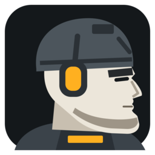

<p align="center"></p>

# ChadScanner

Item info for **Escape from Tarkov** as a large floating card. Shift + Left-click an item in your stash
and the card shows how many you still need for quests and hideout upgrades, and what it is worth.

Native Windows app written in Rust. Successor of the C# RatScanner fork; recognition is done by
[ChadVision](https://github.com/Jsisas/ChadVision) (icon embedding + OCR of EFT's hover tooltip).

## What the card shows

```
NaCl                                   27× needed
QUESTS
4×  Pets Won't Need It                  FIR · now
3×  First in Line            FIR · trader dialogue
3×  Thirsty - Secrets                FIR · 4 quests
HIDEOUT
6×  Medstation 2                              now
10× Medstation 3                       3 upgrades
──────────────────────────────────────────────────
Flea 94 666 ₽                   Therapist 4 339 ₽
Barters 3 · Crafts 5
```

- **n× needed** – everything still needed, after what you have already handed in or marked.
- **Rows** – one per quest or hideout level. The right side says how far away it is: `now`, `2 quests`,
  `3 upgrades`, `Lv 30`, `trader level`, `trader dialogue`, `story step`. `FIR` = must be found in raid;
  `last item` = everything else for that quest or upgrade is already done.
- **Border colour** – amber: needed now · purple: Kappa · brown: later · grey: not needed or low value ·
  green: valuable (≥ 30 000 ₽ per slot).
- **Smart ordering** (default) lists the closest first: now, then fewest quests/upgrades/levels away.
- **Goal** Kappa / Lightkeeper moves other quests to the bottom ("NOT KAPPA").

## Install

1. Build and publish from WSL (see below), or copy a published folder to `C:\ChadScanner`.
2. Set EFT to **Borderless** (Settings → Graphics → Screen mode). Exclusive fullscreen is not supported:
   the card is a normal topmost window and cannot be drawn over an exclusive-fullscreen game.
3. Run `C:\ChadScanner\chadoverlay.exe`. It sits in the tray; right-click for **Settings**,
   **Pause scanning** and **Quit**.

## Settings

| Page | |
|---|---|
| Card | Sections (quests, hideout, barters, crafts), non-FIR needs, rows, Smart / Simple order, Goal, size, close when the mouse leaves, timeout |
| Progress | Where progress is kept: **On this PC** (local file) or **TarkovTracker.org** (API tokens per game mode, with Test); player level and faction; import a TarkovTracker backup |
| Hideout | Built station levels (local progress only) |
| Scanning | Scan button: Shift + Left, Alt + Left, Middle, Mouse 4, Mouse 5 |
| EFT logs | Quest tracking on/off, logs folder |
| About | Log file, settings folder, debug reports |

Changes are saved and applied immediately. The game mode switches by itself when EFT starts a session.

## Progress

- **On this PC** – `%APPDATA%\ChadOverlay\progress.json` in TarkovTracker backup format, so it can be
  imported at tarkovtracker.org. Tasks you finish are filled in from EFT's logs, including ones finished
  while the app was closed. EFT does not log hideout upgrades: set them on the Hideout page.
- **TarkovTracker.org** – reads `GET /progress` (every 5 min, and on a scan when older than 60 s; within the
  free 1000 reads/day) and writes completed/failed tasks from the logs. Items you mark on its needed-items
  page lower the counts on the card. Its API cannot change the hideout.

## Debug report

Press **Ctrl + Shift + F12** right after a scan that went wrong. It saves
`%APPDATA%\ChadOverlay\reports\report-<time>\` with the scan's screenshot, the candidates with scores and
why the scan was accepted or rejected (`report.json`), the screen at that moment and the log tail.

## Build (WSL / Linux)

```
git clone https://github.com/Jsisas/ChadVision.git          # next to this repo
git clone https://github.com/Jsisas/ChadScanner.git
cd ChadScanner && tools/deploy-wsl.sh                     # → C:\ChadScanner
tools/deploy-wsl.sh --out DIR
```

Needs rustup, `lld` (`lld-link`), curl and unzip; the script installs the Windows target and
`cargo-xwin`, prepares ChadVision's models and index, and copies the ONNX Runtime DLL. Quit the app first
(the exe is locked while it runs).

`cargo test` runs the platform-independent parts (data parsing, needs, progress store, log parsing, card
layout) on Linux.

## Files

| Where | What |
|---|---|
| `C:\ChadScanner\` | `chadoverlay.exe`, `onnxruntime.dll`, `data\` (models, index, item images) |
| `%APPDATA%\ChadOverlay\` | `config.json`, `progress.json`, `pending.json` (TarkovTracker writes waiting for retry), `logstate.json` (EFT log read position), `cache\` (tarkov.dev data), `reports\`, `log.txt` |

## Data sources

- Items, quests, hideout, traders, barters, crafts: [json.tarkov.dev](https://json.tarkov.dev), refreshed every 10 min.
- Progress: [TarkovTracker](https://tarkovtracker.org) API or the local file.
- Quest events and game mode: EFT's own log files.

## Icons

`assets/icon.svg` (exe, Settings window) and `assets/tray.svg` (tray). The PNGs next to them are rendered
from the SVGs; `build.rs` embeds `icon-*.png` in the exe.
