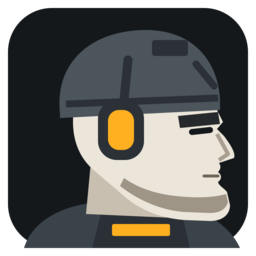

<p align="center"></p>

# ChadScanner

Free **Escape from Tarkov** item scanner for Windows. Shift + Left-click an item in your stash and a large floating card shows how many you still need for quests and hideout upgrades, and what it is worth on the flea market and to traders. Screenshots + OCR only: no memory reading.

**[⬇ Download ChadScanner for Windows](https://github.com/Jsisas/ChadScanner/releases/latest/download/chadscanner-win-x64.zip)** · Windows 10/11 · free · [website](https://chadscanner.sisas.ee/) · [guide](https://chadscanner.sisas.ee/guide/)

## Is it safe?

ChadScanner only takes screenshots around the cursor and reads them with image recognition and OCR. It never reads or writes game memory, injects anything or touches game files; the source of this repo and [ChadVision](https://github.com/Jsisas/ChadVision) is public.

## Install

1. Click the download link above. You get `chadscanner-win-x64.zip`. On the
   [Releases page](https://github.com/Jsisas/ChadScanner/releases/latest) it is the file labelled
   **chadscanner-win-x64.zip**; ignore the other files.
2. Right-click the zip → **Extract All…** → choose a place you own, e.g. `C:\`; this creates `C:\ChadScanner`.
   Not Program Files (updates rewrite this folder), and don't run it from inside the zip.
3. Open the `ChadScanner` folder and double-click `chadscanner.exe`. SmartScreen warns about an unsigned app: **More info → Run anyway**. The
   first start downloads the item data (~180 MB); a toast says when.
4. In EFT set **Borderless** (Settings → Graphics → Screen mode). Exclusive fullscreen is not supported:
   the card is a normal topmost window and cannot be drawn over an exclusive-fullscreen game.
5. Shift + Left-click an item in your stash. ChadScanner sits in the tray; right-click it for **Settings**,
   **Pause scanning**, **Check for updates** and **Quit**.

## Updates

The app checks GitHub 30 s after start and every 6 h. A newer release shows a toast and the tray item
becomes **Update to vX.Y.Z**; clicking it downloads, swaps the files and restarts. Item data is downloaded
again only when it changed. **Check for updates** checks on demand.

## What the card shows

```
NaCl                                   27× needed
QUESTS
4×  Pets Won't Need It                  FIR · now
3×  First in Line            FIR · trader dialogue
3×  Thirsty - Secrets                FIR · 4 quests
HIDEOUT
6×  Medstation 2                              now
10× Medstation 3                       3 upgrades
──────────────────────────────────────────────────
Flea 94 666 ₽                   Therapist 4 339 ₽
Barters 3 · Crafts 5
```

- **n× needed** – everything still needed, after what you have already handed in or marked.
- **Rows** – one per quest or hideout level. The right side says how far away it is: `now`, `2 quests`,
  `3 upgrades`, `Lv 30`, `trader level`, `trader dialogue`, `story step`. `FIR` = must be found in raid;
  `last item` = everything else for that quest or upgrade is already done.
- **Border colour** – amber: needed now · purple: Kappa · brown: later · grey: not needed or low value ·
  green: valuable (≥ 30 000 ₽ per slot).
- **Smart ordering** (default) lists the closest first: now, then fewest quests/upgrades/levels away.
- **Goal** Kappa / Lightkeeper moves other quests to the bottom ("NOT KAPPA").

## Settings

| Page | |
|---|---|
| Card | Sections (quests, hideout, barters, crafts), non-FIR needs, rows, Smart / Simple order, Goal, size, close when the mouse leaves, timeout |
| Progress | Where progress is kept: **On this PC** (local file) or **TarkovTracker.org** (API tokens per game mode, with Test); player level and faction; import a TarkovTracker backup |
| Hideout | Built station levels (local progress only) |
| Scanning | Scan button: Shift + Left, Alt + Left, Middle, Mouse 4, Mouse 5; quest progress keys and non-FIR fill |
| EFT logs | Quest tracking on/off, logs folder |
| About | Log file, settings folder, debug reports |

Changes are saved and applied immediately. The game mode switches by itself when EFT starts a session.

## Progress

- **On this PC** – `%APPDATA%\ChadScanner\progress.json` in TarkovTracker backup format, so it can be
  imported at tarkovtracker.org. Tasks you finish are filled in from EFT's logs, including ones finished
  while the app was closed. EFT does not log hideout upgrades: set them on the Hideout page.
- **TarkovTracker.org** – reads `GET /progress` (every 5 min, and on a scan when older than 60 s; within the
  free 1000 reads/day) and writes completed/failed tasks from the logs. Items you mark on its needed-items
  page lower the counts on the card. Its API cannot change the hideout.

## Quest progress keys

With EFT focused, **Arrow Up** adds one to the first need on the last scanned item's card that still has room
(quests, then hideout; each nearest first) and redraws the card; **Arrow Down** undoes the last one. With *Scanning → Arrow Up also
fills non-FIR needs* off, an item with any FIR need only fills its FIR ones.
The keys still reach the game. Switch them off under Scanning.

With TarkovTracker as the source a change shows on the card at once and is confirmed with a read 30 s after
the last write; if the server does not report what was written, the server's value wins and the
disagreement is logged and toasted.

## TarkovTracker window

A second window, **ChadScanner · TarkovTracker**, embeds tarkovtracker.org (WebView2) so no separate browser is
needed. It opens at start; closing it hides it, and the tray item **TarkovTracker** brings it back. Log in once
(Discord, GitHub, Twitch or email; Google may be refused inside WebView2); the login is kept. The site must be set
to English.

- A scan opens the item's Needed-Items view in the window.
- While the window is open and EFT is focused, **Arrow Up / Down** change one quest objective or hideout part count
  on the site (the first need on the card with room; no Smart Fill) instead of the quest-progress keys above.
  Counts stay identical on both sides; the site's popup lists rows in its own order, and pressing Smart Fill there moves counts between rows (the card follows).
  With the window closed the keys work as described above, for quest objectives only.
- The card redraws after every press from the window's own progress (same game mode only); the next API read confirms it.

## Trader and hideout levels

Outside a raid, with EFT focused, ChadScanner reads EFT's own menus after every left click and writes the result into the TarkovTracker window:

- **Traders** screen: each unlocked trader's loyalty level (roman-numeral badge; crown = 4).
- **Hideout** screen: the level of the station whose detail panel is open.
- Levels only go up. A misread or a real loyalty drop never lowers a trader. Stations are never un-built.
- TarkovTracker checks hideout prerequisites. Levels it rejects show the toast **TarkovTracker refused …: unmet trader, skill or station requirement**.
- Needs the TarkovTracker window (it can be hidden, but not unopened), EFT's menu in English, and Borderless.

## Raid map

EFT's logs tell ChadScanner when a raid starts and ends. At spawn the ChadScanner window opens [tarkovtracker.org](https://tarkovtracker.org)'s own map of the location (the same one that shows your quest objectives); it is shown without taking focus from EFT, even if you had closed it. ChadScanner reads the extraction list EFT shows at spawn (`EXIT01 …`, EFT focused, Borderless) once per raid, and again whenever you press EFT's show-exits key (read from EFT's `Control.ini`), and hides every extract that is not on your list. TarkovTracker's own PMC / Scav / spawn toggles still apply.

- A scan in raid shows the item page; when the card closes (cursor leaves it, or its timeout) the window returns to the map.
- When the raid ends (or EFT quits) the window returns to the page it showed before the raid; scans outside a raid never switch back.
- Press EFT's screenshot key (PrtScn by default) in raid and the map draws a yellow arrow where you stand and which way you face, read from the screenshot's file name in `Documents\Escape from Tarkov\Screenshots`. The map pans only when the arrow is off-screen. The screenshot file is then deleted; screenshots without coordinates (menus) and ones taken while ChadScanner saw no raid are kept. The arrow stays until the next screenshot or raid end.
- Map data: json.tarkov.dev (map ids, extract names) and [tarkov.dev](https://github.com/the-hideout/tarkov-dev)'s `maps.json` (map rotation), cached for 24 h.
  With no data yet the toast **Raid map unavailable** shows; for a location without a map, **No map for this location**.

## Troubleshooting

- **The card doesn't show up** → set EFT to Borderless.
- **It scanned the wrong item** → press **Ctrl + Shift + F12** right after a scan that went wrong. It saves
  `%APPDATA%\ChadScanner\reports\report-<time>\` with the scan's screenshot, the candidates with scores and
  why the scan was accepted or rejected (`report.json`), the screen at that moment and the log tail. Attach it to a [GitHub issue](https://github.com/Jsisas/ChadScanner/issues).
- **"Item data download failed"** → check the internet connection and restart ChadScanner; details are in `%APPDATA%\ChadScanner\log.txt`.
- **Uninstall** → Quit from the tray, then delete the install folder and `%APPDATA%\ChadScanner`.

## Files

| Where | What |
|---|---|
| `C:\ChadScanner\` | `chadscanner.exe`, `onnxruntime.dll`, `data\` (models, index, item images) |
| `%APPDATA%\ChadScanner\` | `config.json`, `progress.json`, `pending.json` (TarkovTracker writes waiting for retry), `logstate.json` (EFT log read position), `tracker-window.json` (TarkovTracker window position), `webview\` (its browser profile: keeps the login), `cache\` (tarkov.dev data, map data), `reports\`, `log.txt` |

## Data sources

- Items, quests, hideout, traders, barters, crafts: [json.tarkov.dev](https://json.tarkov.dev), refreshed every 10 min.
- Quests only TarkovTracker adds (e.g. "Pay the Fare!"): its `tasks-core` endpoint, merged in when json.tarkov.dev lacks them.
- Progress: [TarkovTracker](https://tarkovtracker.org) API or the local file.
- Quest events, game mode, raid start/end: EFT's own log files.
- Raid maps: json.tarkov.dev (`maps`) and tarkov.dev's `maps.json` map configuration; the map itself is tarkovtracker.org's.
- Trader and hideout levels: EFT's Traders and Hideout screens (OCR).

## For developers

Standalone native Windows app written in Rust; recognition is done by
[ChadVision](https://github.com/Jsisas/ChadVision) (icon embedding + OCR of EFT's hover tooltip).

### Build (WSL / Linux)

```
git clone https://github.com/Jsisas/ChadVision.git          # next to this repo
git clone https://github.com/Jsisas/ChadScanner.git
cd ChadScanner && tools/deploy-wsl.sh                     # → C:\ChadScanner
tools/deploy-wsl.sh --out DIR
```

Needs rustup, `lld` (`lld-link`), curl and unzip; the script installs the Windows target and
`cargo-xwin`, prepares ChadVision's models and index, and copies the ONNX Runtime DLL. Quit the app first
(the exe is locked while it runs).

`cargo test` runs the platform-independent parts (data parsing, needs, progress store, log parsing, card
layout) on Linux.

### Release

Bump `version` in `Cargo.toml`, commit, then `git tag vX.Y.Z && git push origin vX.Y.Z`.
`.github/workflows/release.yml` builds with `tools/deploy-wsl.sh` and publishes with
`tools/package-release.sh` (`chadscanner-win-x64.zip`, a data zip when the data key — `data\key.txt`, hash of catalog + models — changed, `manifest.json`). Do not delete old
releases: a newer manifest may point to an older release's data zip.

### Icons

`assets/icon.svg` is the exe, tray and Settings window icon. The PNGs next to it are rendered from the
SVG; `build.rs` embeds `icon-*.png` in the exe.

### Website

`site/` is the landing page at https://chadscanner.sisas.ee/, deployed by `.github/workflows/pages.yml` via `tools/build-site.sh`; `node --test site/main.test.js` tests it.
